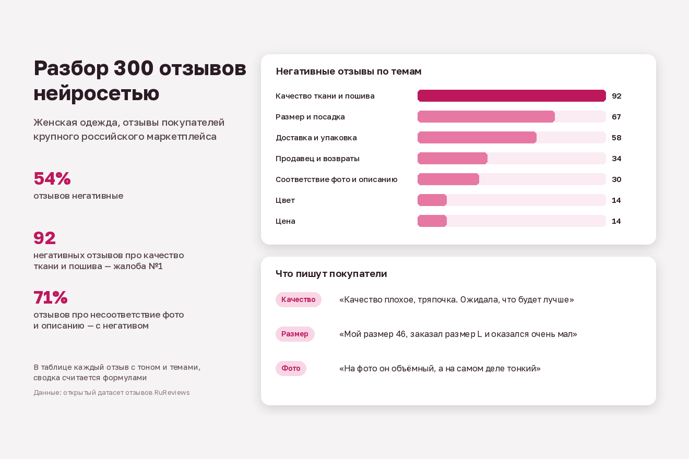

# Разбор отзывов покупателей нейросетью

Скрипт берёт выгрузку отзывов (CSV из кабинета продавца или любого другого источника), отдаёт их нейросети пачками и собирает Excel: тон и темы каждого отзыва, сводку по жалобам и примеры для каждой темы. Задача — за минуты понять, на что жалуются покупатели, вместо того чтобы читать сотни отзывов подряд.



## Как устроено

- Отзывы уходят в GigaChat пачками по 20 штук с жёсткой схемой ответа в JSON: тон и темы только из заданного списка. Ответ модели проверяется: если JSON битый, запрос повторяется, а отзыв, по которому модель так и не ответила, получает тему «Другое».
- Список тем задаётся в начале скрипта и легко меняется под товарную категорию.
- В Excel три листа: все отзывы с разметкой, сводка с долями (считается формулами) и примеры отзывов по каждой жалобе.

## Пример

В `data` лежат 300 отзывов о женской одежде из открытого датасета RuReviews, в `examples` — готовый разбор. Главная жалоба в этой выборке — качество ткани и пошива, на втором месте — размер и посадка. Пример размечен нейросетью по той же схеме тем, что использует скрипт.

## Запуск

```
pip install -r requirements.txt
cp .env.example .env      # впишите ключ GigaChat
python analyze_reviews.py data/отзывы_пример.csv
```

## Тесты

```
pip install pytest
pytest
```

Тест прогоняет весь конвейер с подменённым ответом модели, без сети и ключей.

## Важно

Отзывы покупателей могут содержать персональные данные. Если работаете с чужой выгрузкой, получите согласие владельца данных на отправку текстов во внешний сервис.
